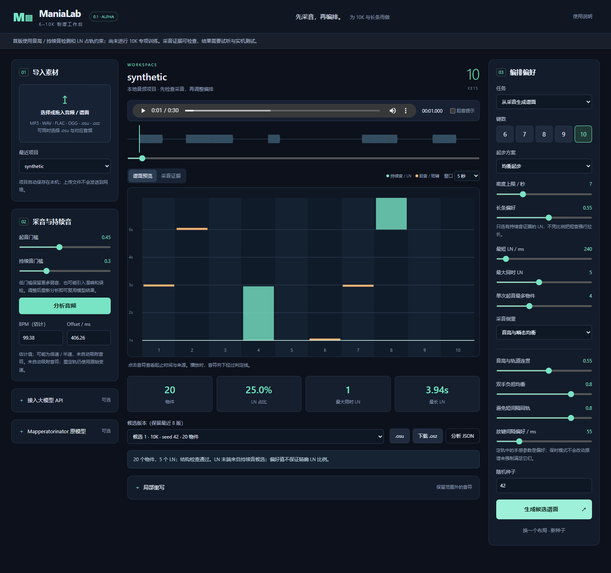

# ManiaLab · 6–10K 制谱工作台

项目导航见[文档索引](docs/README.md)与[脚本索引](scripts/README.md)。

为 **6–10K osu!mania、尤其 10K 和 LN** 制作的本地 Windows 工作台。先分离和检查音乐，再选择起音、持续区间与轨道；支持从音频生成，也支持已有谱面的严格重定轨。

质量目标是对音清楚、段落和声部表达连贯、LN安排合理；参考谱用于学习思路和定位差异，不要求逐音符复刻，见[音乐质量目标](docs/music-quality-target.md)。

**0.1.0-alpha.6-dev.12 · 开发测试版。** [下载 Windows 便携包](https://github.com/zhyzx35607/ManiaLab/releases/tag/v0.1.0-alpha.6-dev.12)。本版重新对齐当前 `main`，源码新增和弦候选差异听审包构建与标签汇总工具；这些是本地研究 CLI，不改变应用运行行为、默认采音或模型。听审音频、模型和逐曲研究产物均不包含在 Windows 便携包中。Kiai 和连续人声乐句仍是可编辑提示与候选，不等于主歌／副歌或人声身份识别；起音、Timing 和逐段表达仍需原声检查及 osu! 试打，尚无证据证明完整音乐性超过 Mapperatorinator。模型使用方式见[乐器采音选择](docs/instrument-choices.md)，本版范围见[dev.12说明](docs/releases/0.1.0-alpha.6-dev.12.md)。

**开发测试版 `0.1.0-alpha.6-dev.2`**：在段落与声部表达流程上，加入已有声轨导入、可选钢琴专用采音、和弦减层保留起音，以及手动“连续起音优先”表达；重建音频程序并校验源码与包内模型身份。下载入口为 [开发测试包](https://github.com/zhyzx35607/ManiaLab/releases/tag/v0.1.0-alpha.6-dev.2)。这是对照测试版本，自动对音、复杂鼓音与LN音乐表达仍未完成验收，研究中的YourMT3伴奏模型和未通过对照的训练权重没有启用。常规alpha.5仍保留，原段落流程说明见 [采音与段落表达修订](docs/music-first-revision.md)。

**dev.3 新增[可选贝斯与其他伴奏采音](docs/instrument-worker.md)**：Tsumugi 专用CPU组件随完整包提供，默认关闭；适用于四／六声部分离或已导入的贝斯、其他伴奏轨。另一个开关允许有来源记录的模型预测音尾参与LN，默认只用起音。吉他、人声继续原引擎。已经完成两权重、两种音尾模式的真实便携前向和缓存核对；全曲18份编排结果及仍存在的主次、量化问题见[全曲对照](docs/tsumugi-fullsong-results.md)。自动音色重分组尚未启用，见[真实结果](docs/instrument-refinement-results.md)。这仍是开发测试版，不能视为音乐质量已验收。

**起音来源修复**：曲中窗口开始前就在持续的声音，不再无条件写成新按键；歌曲开头已发声的区间单独保留。完整156份输入重放说明，直接删掉所有无起音标志的事件会伤到真实开头音，因此采用明确的输入边界策略，保留原始预测与排除原因。结果和仍存在的漏采见[完整复核](docs/tsumugi-onset-provenance.md)。dev.3保留原草稿，相关修复并入dev.4。

**源码研究进展**：已用真实 Mapperatorinator 音频／事件序列完成两轮 6–10K LoRA 实验，修正跨窗 LN 状态、训练／推理条件和模型轨道被覆盖的问题，增加混音／六声部同步试听对照。自由生成尚无稳定收益，10K Hybrid 对照出现 LN 退步，因此未启用研究权重；详见 [音频事件微调记录](docs/mapper-audio-research.md)。

**已有声轨导入**：可直接选择 Nova 等工具导出的鼓、钢琴等声轨，保留原曲时钟，逐乐器采音、分段和试听。支持部分声部，检查长度、缓存身份及失败时旧结果保留；见 [已有声轨使用说明](docs/provided-stems.md)。作者《樱花草》的声部与成品对照、实际训练失败及不足见 [专项研究记录](docs/sakura-source-research.md)。此功能从dev.2测试包开始提供。

**LN 规划研究**：增加无新起音处的独立放手、全曲占轨求解和异常红线校验，重新训练7898份有效谱的条件表达模型；长LN和声部归属仍未过关，权重继续禁用。实际生成、逐曲退步和限制见 [放手规划对照](docs/release-planning-research.md)。

**可选钢琴采音**：dev.2测试包内置默认关闭的钢琴专用入口，只作用于独立钢琴声轨；使用便携 ONNX 运行时，记录音尾依据，阻止把模型截断自动当作 LN 放手。真实钢琴演奏、《樱花草》和运行一致性对照见 [专项记录](docs/piano-acoustic-research.md)。分离输入同时改为浮点音频并修复两级缓存失效，见 [输入审计](docs/raw-pcm-input-audit.md)。这些改动不代表完整制谱已验收。

**声部表达修正**：允许复音和弦以较少层数保留起音，修复超容量时整组被省略的问题，并调整主声部偏好与对音证据的关系。已在同一份六声轨输入上完成6–10K全曲导出检查；详细结果与尚未解决的问题见[起音组与表达层数](docs/chord-expression-research.md)。

**伴奏转录对照**：在原Nova浮点伴奏轨上运行专用转录，完成6–10K全曲选音、定轨及导出比较；补齐强制截断/未决音尾不能自动形成LN的保护，并修正真实弦乐评测漏算跨界长音的问题。钢琴主次和LN表达仍需验证，新伴奏模型尚未进入应用；见[实际编排记录](docs/accompaniment-transcription-research.md)。

**其他乐器采音**：已实际运行 Tsumugi 的贝斯、吉他、人声及其他乐器权重；[完整 100 份吉他／人声结果](docs/tsumugi-guitar-vocal-results.md)显示吉他误采减少但漏音增加，人声两套标注结果一升一降。[候选模型及状态](docs/other-instrument-model-survey-2026-11-10.md)、[35 份弦管乐比较](docs/instrument-extension-results.md)、[ROSVOT 人声退步结果](docs/vocal-transcription-results.md)均保留。开发代码另修正了[起音校准挤在一起和重弹拖尾](docs/basic-pitch-attack-boundary-fix.md)，但完整音符区间仍未整体改善，没有据此发布完成版。

**新增专用模型实测**：已下载并比较小提琴STRAdi、贝斯FiloBass、萨克斯FiloSax及PESTO音高辅助；固定录音的结果未支持替换现有方案，见[模型状态与实测依据](docs/specialist-instrument-models-2026-11-10.md)。源码另修复[钢琴重弹截尾误当LN放手](docs/piano-reattack-boundary.md)，保留起音并公开整曲表达的副作用；这项改动尚未进入旧下载包。

**吉他专用模型对照**：两份新权重×60份完整录音和独立复算已完成。FL模型起音F1为89.36%、完整区间68.81%，高于现有管线73.17%／48.74%；区间仅59份可评，训练重叠未认证，见[完整结果及退步项](docs/hf-guitar-specialists-results.md)。dev.4加入默认关闭的[吉他专用入口](docs/guitar-specialist.md)，已完成实际浮点声轨和源码HTTP整链对照；模型预测音尾须另行开启。采音指标不代表最终LN质量。

**弦管乐专用对照**：[Tsumugi 完整 35 输入三方结果](docs/tsumugi-urmp-results.md)显示起音和完整区间整体改善，混音漏采减少；中提琴等局部起音仍不如 YourMT3。继续用原 Nova 全曲声轨检查实际编排，并准备[音色分组模型](docs/instrument-refinement-protocol.md)对照；音符指标不等于 LN 音乐验收。

**可选连续起音表达**：逐段声部方案可选择“连续起音优先，组尾可延长”，处理钢琴等敲击序列的相互拖尾。自动推荐保持原行为；新主次/长短建议的两轮全曲结果包含鼓取舍退步，详见[表达对照](docs/articulated-expression-research.md)。

**钢琴内部声部研究**：已完成重叠音尾的符号分组适配、77份留出乐谱评价和13项6–10K导出；持续声部识别部分改善，但正常音长、跨小节连续性和上下文稳定性仍不足，未启用应用默认。详见[实际训练与导出](docs/piano-stream-research-2026-11-09.md)及[分段构图修复对照](docs/piano-stream-context-research-2026-11-09.md)。

**持续音数据与声部训练**：已用独立持续事件表示重建136份train/validation源，并完成重叠音尾增强训练；踏板控制有所恢复，交叉旋律与谱表分类仍有退步，研究权重未启用。见[延音线审计](docs/piano-bar-identity-research-2026-11-09.md)和[重叠训练结果](docs/piano-source-event-overlap-2026-11-09.md)。相同1557个《樱花草》钢琴候选的[三权重连接对照](docs/piano-audio-events-2026-11-09.md)已生成原音回放与局部图，尚不能证明稳定旋律或LN质量。另已修复[切段导致组尾误判](docs/piano-articulation-context-2026-11-09.md)。

**后继起音组对照**：在原音符不变的前提下，限制每个来源音只选一组后续起音。重叠模型的模拟踏板误连减少，但复杂验证输入丢失了正确连接，仍未启用；见[解码结果与退步项](docs/piano-successor-decode-2026-11-09.md)。

**后继排序训练**：完成四轮辅助排序训练与逐连接配对核验；重叠输入的解码指标局部提高，但正常输入、交叉旋律和踏板控制仍有退步，新权重没有接入应用。详见[训练结果与未采用原因](docs/piano-successor-ranking-2026-11-09.md)。

**同刻错声部训练**：增加同一时刻已知错声部的排序监督，完成四轮和双基线对照；同刻误连减少，但交叉旋律漏连及重叠和弦完整性退步，继续不启用。详见[本轮改善与退步](docs/piano-same-tick-ranking-2026-11-09.md)。

**更晚候选竞争训练**：仅为有可靠较早后继的同part未知候选增加辅助排序，完成四轮与逐边核验；raw指标局部提高，但完整真组和交叉旋律退步，更晚候选竞争也未改善，研究权重继续禁用。见[训练结果及上下文诊断](docs/piano-later-ranking-2026-11-09.md)和[证明范围与覆盖](docs/piano-later-negative-coverage-2026-11-09.md)。

**排序权重诊断**：保存预测的独立重算确认新负组压低原目标的绝对 logit 梯度权重，但不能认定训练退步原因；见[公式、配对统计和限制](docs/piano-ranking-weight-diagnostic-2026-11-09.md)。

**独立辅助项对照**：保留原目标权重、单独训练可证更晚负组后，模拟踏板部分改善，但交叉旋律、部分完整和弦及错误后继竞争仍未通过预定条件；继续不启用。见[四轮结果及不采用原因](docs/piano-separate-later-ranking-2026-11-09.md)。

**原音与标签核查**：补充[极短高音的波形、频谱和激活对照](docs/piano-attack-evidence-2026-11-09.md)，区分潜在泛音混淆与已观测音尾；另定位[同刻错声部连接及监督覆盖缺口](docs/piano-successor-label-audit-2026-11-09.md)。这些诊断尚未成为自动删音或新LN规则。

**原声频带对照**：完成47个固定候选的原声、三窗频谱及模型激活检查，发现能量增长和共享分音同样覆盖真实叠奏，不能据此自动删音；修正测量中的窗口边界误差并保留不可测状态。见[实际结果与限制](docs/piano-band-evidence-2026-11-10.md)。

**独立声源对照**：83组真实单音叠加与8组同幅度补充定位到弱高音叠奏漏采和延音重复预测；提高总增益没有减少漏采，额外预测增多。已保存波形、频谱与全部检测结果，尚未得到可启用的修复。见[结果与下一步方向](docs/piano-isolated-controls-2026-11-10.md)。

**钢琴模型对照**：Transkun 在11段实录中均提高起音F1，但91份声源控制新增17个漏采，实录也有20个新增遗漏；完整 Nova 钢琴轨仍存在叠加音分歧，未替换应用模型。按键音尾、踏板延音及原声检查见[完整结果与限制](docs/piano-transkun-research-2026-11-10.md)。

**分窗丢音修复研究**：把已识别起音与音尾完整性分开保存，完整重放103份输入后找回两处实录丢音，未增加已知多采；Nova另保留两个音尾未决提案。去重仍有边界局限，未直接启用，见[修复结果](docs/piano-onset-preservation-2026-11-10.md)。

**真实声学适配**：已完成两轮钢琴起音层训练和独立复算。验证仅减少1个额外起音，51个漏音未改善；原声与逐事件检查还发现移除假起音后，前一音尾反而延长约0.85秒。研究权重未启用，见[完整结果与音尾交换](docs/piano-onset-head-research-2026-11-10.md)。

**起音与持续状态联合训练**：两轮双头适配仍未减少漏采，且新增音尾退步；逐参考保护门槛拒绝新权重，保留原模型。完整重放、真实梯度、原声图和逐音对照见[结果及未采用原因](docs/piano-joint-head-research-2026-11-10.md)。

**细分鼓音色研究**：原float全曲复现ADT_STR的重复和未结束问题，已核验PCM与解码并保存原声图。核对历史后撤回重复语法方案，停止未完成的MDB扩展回归；第4列多数差异涉及音色归类，不能只看hi-hat匹配数。见[结果与路线纠偏](docs/drum-adt-str-research-2026-11-10.md)。

**OaF鼓模型对照**：已完成作者分轨与23份真实鼓录音，另核验历史前处理和音色分类口径。部分误报减少，同时有明显漏音；《樱花草》第4列表现退步，不替换默认采音。见[完整结果](docs/oaf-drums-research.md)。

**多乐器身份修复**：修复研究伴奏候选丢失乐器标签，导致跨乐器去重、长短表达及旋律建议互相干扰的问题。完成原全曲6–10K回归；容量竞争仍会挤掉其他声部，标签也不等于真实音色，见[实际变化与限制](docs/instrument-identity-research.md)。未默认启用YourMT3。

**按类别设置段落表达**：已有模型类别的候选可逐段分别选择持续音、连续起音、起音或不采，默认继承原声部方案；支持保存、项目重开和实际生成。默认采音未因此获得音色识别能力，见[使用与验证范围](docs/instrument-expression-controls.md)。



## 下载即用

1. 打开 [Releases](https://github.com/zhyzx35607/ManiaLab/releases)，下载最新已发布版本的 Windows ZIP；不要从 Tags 页面下载源码包来安装。
2. **完整解压**后双击 `ManiaLab.exe`。程序打开本机浏览器界面，关闭控制台窗口退出。
3. 导入音频 → 深度分析 → 检查 BPM / Offset 并试听 → 选择本曲编排建议或手调参数 → 生成候选 → 下载 `.osz` → 拖入 osu!。

不熟悉 BPM / Offset、LN 比例和声部参数时，先看 [第一次使用](docs/quick-start.md)。

完整包自带 CPU 运行时、四／六声部分离模型、节拍模型、音高模型和 FFmpeg。日常功能离线可用，不需要 Python、Docker、CUDA 或手动部署。仅 API 助手和可选 Mapperatorinator 原模型首次安装需要联网。面向 Windows 10/11 x64；本机 Windows 10 已验证，另一台电脑仍需实际测试。

首次全曲深度分析会真实运行多个模型，耗时取决于长度与 CPU；再次调整门槛会复用已完成的模型结果。界面显示实际耗时和缓存状态。Release 中随 ZIP 提供的 `*-SHA256SUMS.txt` 是对应版本的校验文件，正常使用只需下载 ZIP。

本轮使用方式见[乐器采音选择](docs/instrument-choices.md)，新增路径的真实运行见[吉他应用验证](docs/hf-guitar-application-results.md)及同一Release附带的验证JSON。此前[alpha.5](docs/alpha5-validation.md)和[alpha.4](docs/release-verification.md)的检查保留为历史记录。

项目自动保存到 `%LOCALAPPDATA%\ManiaLab\projects`，日志在 `%LOCALAPPDATA%\ManiaLab\ManiaLab.log`。迁移项目可复制项目文件夹。

## 音频、Timing 和 LN

- **深度采音**：默认 Hybrid Demucs 分离鼓、贝斯、人声和其余伴奏；可选 HTDemucs 六声部另分吉他和钢琴，逐声部提取起音及持续音。六声部没有证明整体更准，保留四声部用于对照。过滤极弱分离残留；对进入近静音的模型尾巴做有界回收。可逐声部试听、查看波形及原始检测时间。
- **节拍校准**：起音拟合全曲 BPM 与 Offset，Beat This! 辅助判断半速/倍速。默认整理小数噪声，例如 `210.00073 → 210`；保留常见 `.25/.333/.5/.667/.75`。真实小数若取整会造成漂移，会另列精确候选并要求试听。手动 BPM 不强制取整。
- **明确的时间基准**：新项目默认「制谱提前量」22.5ms，对应用户参考工具的补偿；设 0 使用原始音频时间。这是可见的制谱选择，不是解码纠错。原始采音保留，换算只发生一次。osu! 官方编辑器采用 20ms 的波形视觉补偿，背景及差异见 [Timing 调查](docs/timing-investigation-165340.md)。不同音源或环境可能需要调整。
- **完整落线**：短键起点、LN 起止量化到 3/4/6/8/12/16 拍内细分。导出回读实际 `.osu` 红线，允许整数毫秒存储产生的最多 0.501ms 舍入误差。量化移动超过 30ms 的起音会单独列出。**落线不等于采音正确。**
- **LN 取舍**：先在全曲密度与和弦约束下选择起音，再选择有持续依据且不堵轨的 LN。目标比例是 LN 数÷物件数，显示实际值及约束下可达值。可调最短 LN、同时占轨、声部取舍和放键间隔。
- **跨音高人声长条**：连续的人声可跨过音高变化形成一条 LN；保留支撑它的音高候选与连续覆盖率，不跨明显呼吸缺口。它是可调的表达选择，并非人工乐句标注。
- **对音实验室**：音乐和节拍/起止提示音混入同一个 PCM 片段，支持 Offset A/B、单声部与 LN 放键试听。提示按实际导出时间播放，不额外补偿。放大波形可切换原始时钟与制谱时钟。
- **LN 键型与修正**：可调同手 Hybrid 配合、放手协调、反键接续；显示分段占轨与独立放手位置。可选音符修改起止、轨道、长短键或增删，波形选点可直接用于修正。每次保存为新候选；严格保时模式仅允许换轨。详见 [LN 设计与对照](docs/ln-design-notes.md)。
- **定位问题位置**：点击可疑拍线区间即可打开对应试听，或逐一比较开头、中间、结尾。改变 Timing 会清除旧诊断，避免沿用过期提示。

自动 Timing 不稳定时会阻止直接量化；输入参考 Timing 或手动校准并试听确认后可继续。当前不自动生成多段变速红线。已有变速谱面可严格重定轨并保留原始 TimingPoints。

## 定轨与编排助手

分析后无需 API 即可比较 **旋律与放手 / 均衡 Hybrid / 密集多声部**。每个方案按本曲起音与持续音提出分段密度、LN 配额和配合倾向，并显示共同收尾、错开进入、长按中的短键等可尝试的表达。采用方案实际影响生成，也可继续调全局参数；换 BPM、键数或采音证据后需要重新选择。分段目前是分析窗口，不是已识别的主歌副歌；可另行导入参考谱的书签或 Kiai 状态切换作为可编辑边界提示，它们也不代表自动识别了歌曲语义段落。建议不等于星级。见 [编排设计与情况清单](docs/arrangement-design.md)。

参考范围已从 [35 份中文 LN 开发观察](docs/ln-reference-study.md) 扩展到不限语言、曲风的 6–10K Ranked / Loved 查询。Sayobot 用于发现与谱面数据下载，保留哈希、状态来源、缺失项和去重记录。下载、统计、轨道训练与音频真值是不同步骤，覆盖范围与筛选协议见 [语料扩充协议](docs/corpus-expansion-protocol.md)。

本次训练快照 **7,907 份谱**，其中 10K 585 份；10K 中 LN≥50% 的只有 14 份，专项覆盖仍有限。五种键数分别通过轨道先验的验证门槛，完整谱面与真实歌曲对照保留了退步项。详见 [训练报告](docs/training-report.md)。

连续 beam search 保存多排候选、LN 占轨、放键和双手负担状态；6–10K 使用明确的手指布局，7K/9K 中键按共享拇指处理。搜索失败时尝试完整和弦匹配。可切换 alpha.3 的逐排引擎对比。

小型神经网络从按歌曲分组的人工谱面中学习**固定起止时间下的轨道偏好**。它不能创造声音、决定 LN 长度或证明手感好；只对达到验证条件的键数启用，权重可设为 0。数据、划分和成绩见 [训练报告](docs/training-report.md)。

严格重定轨保留原谱数量、起止时间、类型、音效和变速，只重新分配轨道。轨道容量不足时报告冲突时间，不删音或缩短 LN。变速谱按当地 BPM 计算定轨偏好。

可导入喜欢的 `.osu` 作为数量分布参考，自动提取密度、LN 比例、持续长度与占轨规模。它不复制原谱音符，不改变当前目标键数；实际长条仍需本曲音频依据。

保留最近 8 个候选，可更换种子比较布局；局部重写锁定范围外物件。谱面检查会定位短放键接续、快速同轨和同手 LN 配合密集的位置，它们是试打线索，可能属于有意设计，不是错误判定或星级。

可选大模型 API 支持兼容 `/chat/completions` 的服务，读取段落统计、现有谱面检查与文字要求，返回全局/分段参数，包括声部权重和人声长条倾向。API 只接收统计和文字，不接收音频，不生成音符时间；密钥不落盘。兼容协议经过本地模拟服务验证，真实供应商仍取决于其接口与模型。

可选 Mapperatorinator V32 仍作为对照引擎：按钮自动安装独立 CPU 环境并下载固定版本 mania 权重。它没有接受本项目 10K 专训，首次需要网络与额外数 GB 空间。可传入已确认的 BPM / Offset；源码开发版保留模型生成的轨道，之后可主动重新定轨。运行会将结果设为当前项目的新原谱。它还未与逐声部采音合并训练，不应把可选接口当成已完成的新采音模型。

## 当前限制

分离会串音，Basic Pitch 会漏音、把谐波当音高或错判尾巴；鼓的复杂细分和非固定 BPM 歌曲仍困难。持续音与人声乐句需要回听，不能靠提高 LN 比例补救采音。

结构检查、统计对照和小型先验验证不能代替玩家盲评。没有自动星级评估、成熟的手工拖音编辑器或保证可发布的制谱质量。支持不超过 20 分钟音频、单次上传 512MB；导入谱包保留音频、常见图片与音效，不复制视频和外部 `.osb`。

## 上游与来源

- [Mapperatorinator](https://github.com/OliBomby/Mapperatorinator)，commit `5884d1bcb57494f09fe3d74f3a6b58ca0d2960aa`：复用 Event 表示、模板和可选原模型运行器；原目录未修改。
- [Torosu](https://github.com/Manolo-dl/Torosu)，commit `b283791f46622b0dd1f47f53afa10bd62d700e66`：参考手指布局、LN 状态和多排搜索思路，独立实现严格保时的定轨器。Inverse 补空间不是音频持续音识别。
- NovaMSS：检查本地程序确认其包含的分离架构，接入对应公开的六声部 Demucs 路径。未复用其私有加密模型，不声称输出等同。研究与四／六声部对照见 [多声部记录](docs/multistem-research.md)。
- [Basic Pitch](https://github.com/spotify/basic-pitch)、[torchaudio Hybrid Demucs](https://github.com/pytorch/audio)、[Beat This!](https://github.com/CPJKU/beat_this)：模型来源、固定哈希和许可证见 `assets/*manifest*`、`assets/deep-models.json`、[第三方声明](THIRD_PARTY_NOTICES.md)。

用户音频、下载谱面、参考 EXE、API 密钥和研究中间文件不进入公开仓库或 Release。

## 开发、构建和验证

主程序与音频 worker 使用独立环境：

```powershell
uv venv .venv --python 3.12
uv pip sync --python .venv\Scripts\python.exe requirements-lock.txt
.venv\Scripts\python.exe scripts\fetch_audio_models.py
uv venv .venv-audio --python 3.12
uv pip sync --python .venv-audio\Scripts\python.exe --extra-index-url https://download.pytorch.org/whl/cpu --index-strategy unsafe-best-match requirements-deep-lock.txt
.venv-audio\Scripts\python.exe scripts\build_audio_worker.py
.venv\Scripts\python.exe launcher.py
.venv\Scripts\python.exe -m pytest -q
.venv\Scripts\python.exe scripts\build_windows.py
```

浏览器脚本需 Playwright 和 Edge，可用 `MANIALAB_URL` 指定本地服务。验证范围、真实音频对照与不足见 [验证记录](docs/validation.md)。本地语料审计用 `scripts/audit_corpus.py`；采集与训练脚本见 [训练计划](docs/training-plan.md)。
