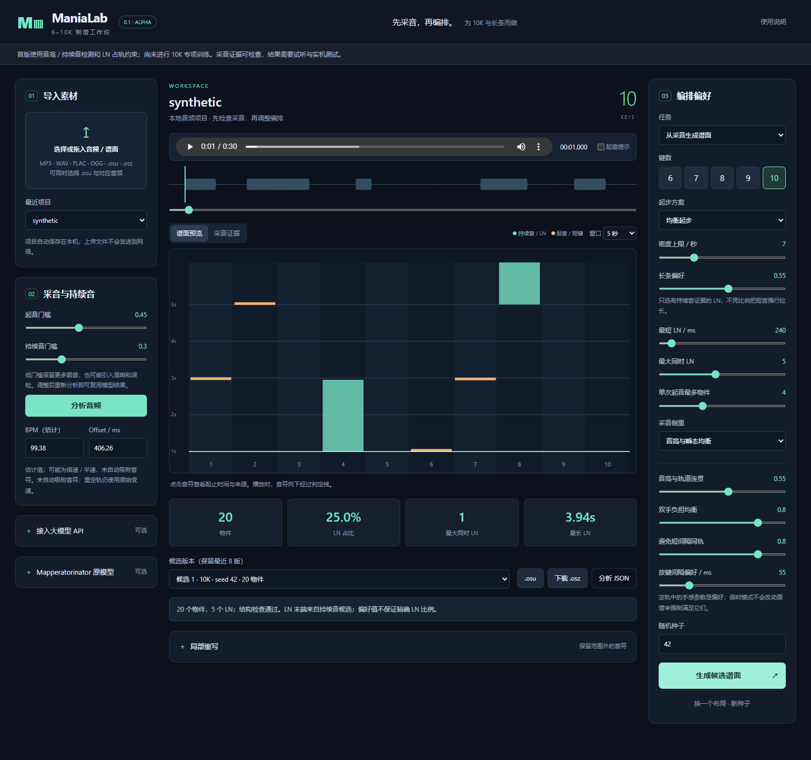

# ManiaLab · 6–10K 制谱工作台

项目导航见[文档索引](docs/README.md)与[脚本索引](scripts/README.md)。

为 **6–10K osu!mania、尤其 10K 和 LN** 制作的本地 Windows 工作台。先分离和检查音乐，再选择起音、持续区间与轨道；支持从音频生成，也支持已有谱面的严格重定轨。

质量目标是对音清楚、段落和声部表达连贯、LN安排合理；参考谱用于学习思路和定位差异，不要求逐音符复刻，见[音乐质量目标](docs/music-quality-target.md)。

**0.1.0-alpha.6-dev.28 · Extended profile · Windows x64 公开试用预发布版。** [直接下载 Extended ZIP](https://github.com/zhyzx35607/ManiaLab/releases/download/v0.1.0-alpha.6-dev.28/ManiaLab-0.1.0-alpha.6-dev.28-windows-x64-extended.zip)，校验值见 Release 附件中的 `SHA256SUMS.txt`。包含四／六声部分离、节拍模型、钢琴专用模型、吉他 FL、Tsumugi 贝斯／其他伴奏模型和 CPU 运行时；Mapperatorinator 权重按需单独下载。批量分析成功后，可统一选择键数、键型、制谱预设和密度，一次生成全部成功歌曲，再逐首下载 OSZ 或下载整批 ZIP。纯起音生成不会写 LN，切换预设时旧候选会显示实际 LN 并要求重生成后才能导出。Windows 自动发布工作流仍只验证 Core；Extended 发布流程会在 Windows runner 上独立构建并验证。合成输入只能证明组件加载、执行与身份匹配，不证明真实歌曲采音质量、Timing 或游戏手感。Demucs 权重的独立再分发授权及 Tsumugi 训练录音权利仍未核实。完整范围和验证限制见[dev.28 说明](docs/releases/0.1.0-alpha.6-dev-28.md)与[第三方声明](THIRD_PARTY_NOTICES.md)。

当前入口： [项目状态与重规划](docs/project-status-and-roadmap-2026-11-24.md) · [快速开始](docs/quick-start.md) · [组件范围](docs/instrument-choices.md) · [架构与开发](docs/architecture.md) · [续接进度](docs/PROGRESS.md)。历次模型比较、未采用权重与旧版本入口集中在[研究历史](docs/research-history.md)。

Windows validation workflow 的便携门禁仍固定为 `core`。dev.28 Extended 使用单独的精确 tag 发布流程，不等于 Extended 已获正式稳定支持；dev.23 Core 与历史 Release 的内容和说明保持不变。

dev.28 在 dev.27 的便携能力上增加统一批量制谱和整批 OSZ ZIP 下载，并澄清纯起音预设与旧候选的关系。发布源码与验证范围以本页版本及[dev.28 说明](docs/releases/0.1.0-alpha.6-dev-28.md)为准；完整工程与音乐验收状态见[检查与优化记录](docs/project-review-20261117.md)、[工程与音乐验收](docs/acceptance-20261118.md)、[评审回收流程](docs/human-review-integrity.md)及[续接进度](docs/PROGRESS.md)。

2026-11-18 源码已核对真实多难度谱包的编辑与重开，并用两首外部歌曲运行了完整采音到导出流程。结果与试听、试打入口见[工程与音乐验收记录](docs/acceptance-20261118.md)。



## 下载即用

1. [直接下载 dev.28 Extended ZIP](https://github.com/zhyzx35607/ManiaLab/releases/download/v0.1.0-alpha.6-dev.28/ManiaLab-0.1.0-alpha.6-dev.28-windows-x64-extended.zip)；也可先看 [Release 说明](https://github.com/zhyzx35607/ManiaLab/releases/tag/v0.1.0-alpha.6-dev.28)。不要从 Tags 页面下载源码包。下载和解压建议留出约 4 GiB 空间。
2. 完整解压生成的 ZIP 后双击 `ManiaLab.exe`。程序打开本机浏览器界面，关闭控制台窗口退出。
3. 导入音频 → 深度分析 → 检查 BPM / Offset 并试听 → 选择本曲编排建议或手调参数 → 生成候选 → 下载 `.osz` → 拖入 osu!。

不熟悉 BPM / Offset、LN 比例和声部参数时，先看 [第一次使用](docs/quick-start.md)。

dev.28 Extended 便携包自带 CPU 运行时、四／六声部分离、Beat This、钢琴、吉他与 Tsumugi 模型及 FFmpeg。日常功能不需要 Python、Docker 或 CUDA；首次使用可选 Mapperatorinator 后端时需要网络下载模型。面向 Windows 10/11 x64；本机 Windows 10 已验证，另一台电脑仍需实际测试。

分析能力取决于便携包 profile；程序仅调用当前包内可用的模型，并可复用已完成的缓存结果。界面显示实际耗时和缓存状态。Release 中的 `*-SHA256SUMS.txt` 是对应版本的校验文件，可用于核对下载的 ZIP。

本版各专用模型默认关闭或需在对应采音选项中选择；具体能力以 ZIP 内 `release-manifest.json` 与[dev.28 验证说明](docs/releases/0.1.0-alpha.6-dev-28.md)为准。

项目自动保存到 `%LOCALAPPDATA%\ManiaLab\projects`，日志在 `%LOCALAPPDATA%\ManiaLab\ManiaLab.log`。迁移项目可复制项目文件夹。

## 音频、Timing 和 LN

- **深度采音（Extended 包含）**：Hybrid Demucs 四声部和 HTDemucs 六声部分离可切换运行。六声部没有证明整体更准，保留四声部用于对照；还可逐声部提取起音及持续音、过滤极弱分离残留，对进入近静音的模型尾巴做有界回收，并试听声部、查看波形及原始检测时间。该包中的 Demucs 权重再分发授权仍未核实，详见[第三方声明](THIRD_PARTY_NOTICES.md)。
- **节拍校准**：起音拟合全曲 BPM 与 Offset；Beat This! 辅助仅适用于包含该模型的构建，本 Extended 包已包含。默认整理小数噪声，例如 `210.00073 → 210`；保留常见 `.25/.333/.5/.667/.75`。真实小数若取整会造成漂移，会另列精确候选并要求试听。手动 BPM 不强制取整。
- **明确的时间基准**：新项目默认「制谱提前量」22.5ms，对应用户参考工具的补偿；设 0 使用原始音频时间。这是可见的制谱选择，不是解码纠错。原始采音保留，换算只发生一次。osu! 官方编辑器采用 20ms 的波形视觉补偿，背景及差异见 [Timing 调查](docs/timing-investigation-165340.md)。不同音源或环境可能需要调整。
- **完整落线**：短键起点、LN 起止量化到 3/4/6/8/12/16 拍内细分。导出回读实际 `.osu` 红线，允许整数毫秒存储产生的最多 0.501ms 舍入误差。量化移动超过 30ms 的起音会单独列出。**落线不等于采音正确。**
- **LN 取舍**：先在全曲密度与和弦约束下选择起音，再选择有持续依据且不堵轨的 LN。目标比例是 LN 数÷物件数，显示实际值及约束下可达值。可调最短 LN、同时占轨、声部取舍和放键间隔。
- **跨音高人声长条**：连续的人声可跨过音高变化形成一条 LN；保留支撑它的音高候选与连续覆盖率，不跨明显呼吸缺口。它是可调的表达选择，并非人工乐句标注。
- **对音实验室**：音乐和节拍/起止提示音混入同一个 PCM 片段，支持 Offset A/B、单声部与 LN 放键试听。提示按实际导出时间播放，不额外补偿。放大波形可切换原始时钟与制谱时钟。
- **LN 键型与修正**：可调同手 Hybrid 配合、放手协调、反键接续；显示分段占轨与独立放手位置。可选音符修改起止、轨道、长短键或增删，波形选点可直接用于修正。每次保存为新候选；严格保时模式仅允许换轨。详见 [LN 设计与对照](docs/ln-design-notes.md)。
- **定位问题位置**：点击可疑拍线区间即可打开对应试听，或逐一比较开头、中间、结尾。改变 Timing 会清除旧诊断，避免沿用过期提示。

自动 Timing 不稳定时会阻止直接量化；输入参考 Timing 或手动校准并试听确认后可继续。当前不自动生成多段变速红线。已有变速谱面可严格重定轨并保留原始 TimingPoints。

## 定轨与编排助手

分析后无需 API 即可比较 **旋律与放手 / 均衡 Hybrid / 密集多声部**。每个方案按本曲起音与持续音提出分段密度、LN 配额和配合倾向，并显示共同收尾、错开进入、长按中的短键等可尝试的表达。采用方案实际影响生成，也可继续调全局参数；换 BPM、键数或采音证据后需要重新选择。分段目前是分析窗口，不是已识别的主歌副歌；可另行导入参考谱的书签或 Kiai 状态切换作为可编辑边界提示，它们也不代表自动识别了歌曲语义段落。建议不等于星级。见 [编排设计与情况清单](docs/arrangement-design.md)。

参考范围已从 [35 份中文 LN 开发观察](docs/ln-reference-study.md) 扩展到不限语言、曲风的 6–10K Ranked / Loved 查询。Sayobot 用于发现与谱面数据下载，保留哈希、状态来源、缺失项和去重记录。下载、统计、轨道训练与音频真值是不同步骤，覆盖范围与筛选协议见 [语料扩充协议](docs/corpus-expansion-protocol.md)。

本次训练快照 **7,907 份谱**，其中 10K 585 份；10K 中 LN≥50% 的只有 14 份，专项覆盖仍有限。五种键数分别通过轨道先验的验证门槛，完整谱面与真实歌曲对照保留了退步项。详见 [训练报告](docs/training-report.md)。

连续 beam search 保存多排候选、LN 占轨、放键和双手负担状态；6–10K 使用明确的手指布局，7K/9K 中键按共享拇指处理。搜索失败时尝试完整和弦匹配。可切换 alpha.3 的逐排引擎对比。

小型神经网络从按歌曲分组的人工谱面中学习**固定起止时间下的轨道偏好**。它不能创造声音、决定 LN 长度或证明手感好；只对达到验证条件的键数启用，权重可设为 0。数据、划分和成绩见 [训练报告](docs/training-report.md)。

严格重定轨保留原谱数量、起止时间、类型、音效和变速，只重新分配轨道。轨道容量不足时报告冲突时间，不删音或缩短 LN。变速谱按当地 BPM 计算定轨偏好。

可导入喜欢的 `.osu` 作为数量分布参考，自动提取密度、LN 比例、持续长度与占轨规模。它不复制原谱音符，不改变当前目标键数；实际长条仍需本曲音频依据。

保留最近 8 个候选，可更换种子比较布局；局部重写锁定范围外物件。谱面检查会定位短放键接续、快速同轨和同手 LN 配合密集的位置，它们是试打线索，可能属于有意设计，不是错误判定或星级。

可选大模型 API 支持兼容 `/chat/completions` 的服务，读取段落统计、现有谱面检查与文字要求，返回全局/分段参数，包括声部权重和人声长条倾向。API 只接收统计和文字，不接收音频，不生成音符时间；密钥不落盘。兼容协议经过本地模拟服务验证，真实供应商仍取决于其接口与模型。

可选 Mapperatorinator V32 仍作为对照引擎：按钮自动安装独立 CPU 环境并下载固定版本 mania 权重。它没有接受本项目 10K 专训，首次需要网络与额外数 GB 空间。可传入已确认的 BPM / Offset；源码开发版保留模型生成的轨道，之后可主动重新定轨。运行会将结果设为当前项目的新原谱。它还未与逐声部采音合并训练，不应把可选接口当成已完成的新采音模型。

## 当前限制

分离会串音，Basic Pitch 会漏音、把谐波当音高或错判尾巴；鼓的复杂细分和非固定 BPM 歌曲仍困难。持续音与人声乐句需要回听，不能靠提高 LN 比例补救采音。

结构检查、统计对照和小型先验验证不能代替玩家盲评。没有自动星级评估、成熟的手工拖音编辑器或保证可发布的制谱质量。支持不超过 20 分钟音频、单次上传 512MB；导入谱包保留音频、常见图片与音效，不复制视频和外部 `.osb`。

## 上游与来源

- [Mapperatorinator](https://github.com/OliBomby/Mapperatorinator)，commit `5884d1bcb57494f09fe3d74f3a6b58ca0d2960aa`：复用 Event 表示、模板和可选原模型运行器；原目录未修改。
- [Torosu](https://github.com/Manolo-dl/Torosu)，commit `b283791f46622b0dd1f47f53afa10bd62d700e66`：参考手指布局、LN 状态和多排搜索思路，独立实现严格保时的定轨器。Inverse 补空间不是音频持续音识别。
- NovaMSS：检查本地程序确认其包含的分离架构，接入对应公开的六声部 Demucs 路径。未复用其私有加密模型，不声称输出等同。研究与四／六声部对照见 [多声部记录](docs/multistem-research.md)。
- [Basic Pitch](https://github.com/spotify/basic-pitch)、[torchaudio Hybrid Demucs](https://github.com/pytorch/audio)、[Beat This!](https://github.com/CPJKU/beat_this)：模型来源、固定哈希和许可证见 `assets/*manifest*`、`assets/deep-models.json`、[第三方声明](THIRD_PARTY_NOTICES.md)。

用户音频、下载谱面、参考 EXE、API 密钥和研究中间文件不进入公开仓库或 Release。

## 开发、构建和验证

主程序与音频 worker 使用独立环境：

```powershell
uv venv .venv --python 3.12
uv pip sync --python .venv\Scripts\python.exe requirements-lock.txt
.venv\Scripts\python.exe scripts\fetch_audio_models.py
uv venv .venv-audio --python 3.12
uv pip sync --python .venv-audio\Scripts\python.exe --extra-index-url https://download.pytorch.org/whl/cpu --index-strategy unsafe-best-match requirements-deep-lock.txt
.venv-audio\Scripts\python.exe scripts\fetch_piano_model.py
.venv-audio\Scripts\python.exe scripts\build_audio_worker.py
.venv\Scripts\python.exe launcher.py
.venv\Scripts\python.exe -m pytest -q
.venv\Scripts\python.exe scripts\build_windows.py --profile standard
```

以上用于干净检出和本机工程验证；dev.26 的 Extended 包为公开试用版本，Windows 自动发布门禁仍固定验证 `core`。已有旧钢琴模型时先保留旧文件，按[模型与构建说明](docs/development.md)准备当前版本，构建会把选定模型规范为包内固定路径。

浏览器回归独立使用合成项目，不需要模型下载：`npm ci --ignore-scripts` → `npx playwright install chromium` → `npm run test:ui`。详见[开发与验证](docs/development.md)。验证范围、真实音频对照与不足见 [验证记录](docs/validation.md)。本地语料审计用 `scripts/audit_corpus.py`；采集与训练脚本见 [训练计划](docs/training-plan.md)。
