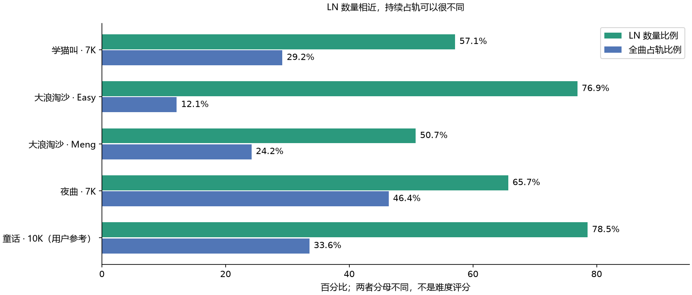

# 中文 LN 参考研究：从小样本理解问题

这批 35 份谱用于发现表达差异和开发对照，已经参与开发，不是盲测集，也不是本次扩大训练的全部语料。6K/7K/8K/9K/10K 分别为 3/17/1/1/13 份。后续采集已扩展为不限语言、曲风的 Ranked / Approved / Loved 6–10K 谱。

固定选择清单 SHA256：`0be3f34cb4bef5036cc8413af398effee431bc85c0d6fe688118943c65fc42ba`。测量脚本为 `scripts/study_ln_references.py`。原谱、音乐和分析缓存不进入发行包。

## 观察到什么

| 参考谱 ID | 版本 | 键数 | LN 数量比例 | 全曲占轨比例 | LN 中位拍数 |
|---|---|---:|---:|---:|---:|
| 4201381 | 学猫叫 · CS' 7K Wo Shi Ni De Mao | 7 | 57.11% | 29.20% | 0.5 |
| 4438589 | 大浪淘沙 · Easy | 7 | 76.89% | 12.11% | 1.0 |
| 4035790 | 大浪淘沙 · Meng | 7 | 50.74% | 24.20% | 0.5 |
| 2473984 | 夜曲 · Death Love | 7 | 65.70% | 46.38% | 1.0 |
| 5848413 | 童话 · I will become... | 10 | 78.55% | 33.56% | 1.0 |

占轨比例是所有 LN 按住毫秒之和 ÷（有效谱长 × 键数），不是音乐持续音比例，也不是难度分数。《童话》属于用户风格观察组，未作为 Ranked / Loved 质量标签加入核心训练。

《大浪淘沙》Easy 的 LN 比例高于 Meng，占轨却只有后者的一半左右。不能把 LN 比例当成难度旋钮；还必须考虑同时保持几根、释放是否错开、另一只手或同手还有多少短键。

《学猫叫》1406 根 LN 中有 682 根短于 240ms。把所有短 LN 直接删成短键，会损失已有参考谱的重要表达。建议中的最短 LN 因此会参考当前 BPM，用户仍可修改。

同曲同音源的不同难度中，既有保留的起音，也有 LN 与短键互换、尾端延长或缩短。比较按 `AudioFilename + 键数` 分组，同时时刻按一对一匹配，不能拿整个谱包所有难度都当作同一首歌，也不能把一个和弦音反复匹配多次。

## 与音乐证据的对照

实际分析了 5 个 60 秒片段（原曲 30–90 秒），边缘各 3 秒不参与统计。包含 138 个至少约两拍的参考 LN 区间。分离声部、持续音覆盖、内部起音和缺口由模型检测；没有人工逐音标注，也没有听评结论。

- 《学猫叫》57.578–58.751 秒的一根参考长条跨越 3 个检测音高，人声覆盖约 99.83%、最大检测空隙约 2ms。它支持“持续手势可以跨音高”的候选解释，不能证明作者实际在映射某个音节。
- 《Mojito》77.598–79.163 秒的参考区间在人声检测中覆盖为 0，而 `other` 覆盖约 96.17%。因此不能把长 LN 一律解释为人声。
- 对照分别保留 0ms 与 22.5ms 两种时钟约定，没有以“哪个补偿更像参考谱”自动拟合采音真值。

这些统计不能算作转录 F1：作者会主动省音、合并或改变表达。真正评估采音还需要独立的起止标注；验证音乐性还需要试听和玩家试打。

## 如何落到程序里

当前程序增加了本曲证据支持的三种编排建议、分段密度与 LN 配额、短 LN 阈值、持续音锚点与放手机会说明。最终起止仍由本曲检测、已确认的 Timing 和量化决定；定轨搜索比较占轨、同手 Hybrid、独立放手及反键接续。

尚未训练“听到一个乐句就预测其最佳 LN 长度”的模型，也没有把这些参考音符拼贴到新歌中。更完整的情况与实现边界见 [编排设计](arrangement-design.md)。
